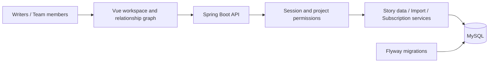

# NovelGraph | Story Worldbuilding & Plot Management Platform

[简体中文](README.md) | **English**

**Turn scattered characters, events and relationships into a creative workspace you can edit, connect and revisit.**

NovelGraph is a Java + Vue full-stack portfolio project demonstrating business modeling, API development, access control and visual interactions. It is a personal showcase project, not a paid client case study or a claim of commercial-scale operation.

[Case study and demo script (Chinese)](docs/CASE_STUDY.md) · [Detailed setup (Chinese)](docs/SETUP.md) · [Validation record (Chinese)](docs/VALIDATION.md)

## The Problem

Novel writing involves characters, events, locations, factions and secrets. Ordinary documents make their connections hard to follow, and collaborators can overwrite each other's changes. NovelGraph organizes this information into structured data and relationship graphs, with team permissions, snapshot restoration and exports for different reading perspectives.

## Features & Engineering Capabilities

| Product feature | Engineering capability |
| --- | --- |
| Characters, events, locations, factions and relationship graphs | Business modeling, related data management and Vue Flow interactions |
| Accounts, workspaces, team members and project permissions | Session authentication, tenant isolation and role-based authorization |
| Autosave, version checks and snapshot restoration | Concurrent edit checks and data version management |
| Text extraction prompts and JSON import | Protocol validation, preview, transaction rollback, reference mapping and duplicate-submission handling |
| Subscription quotas, orders and administration | Quota enforcement, order idempotency and manual activation workflows |
| Author and reader exports | Chapter-based information reveals and structured content output |

## Technology

- Backend: Java 8, Spring Boot 2.7.18, MyBatis-Plus, MySQL and Flyway.
- Frontend: Vue 3, TypeScript, Vite, Vue Flow and Pinia.
- Authentication: Cookie sessions, PBKDF2 password hashing, CSRF validation for write requests and origin checks.
- Verification: JUnit / Spring integration tests, an H2 test database, Node frontend tests and TypeScript checks.



## Code Navigation

- `backend/src/main/java/com/aiwriter/saas/security`: Sessions, passwords and request validation.
- `backend/src/main/java/com/aiwriter/saas/service/impl`: Core business implementations.
- `backend/src/main/resources/db/migration`: Database migrations.
- `backend/src/test`: Tests for isolation, version conflicts, import rollback, orders and related workflows.
- `frontend/src/saas`: Editor, team, account and administration pages.

## Run Locally

Requirements: JDK 8, Maven, Node.js / npm and MySQL.

Create a separate empty MySQL database named `novelgraph`. Do not use an existing business database: migration V5 removes legacy application tables.

From the repository root, create a local configuration file:

```powershell
New-Item -ItemType Directory -Force backend/.local
Copy-Item backend/local-settings.example.json backend/.local/settings.json
```

Edit `settings.json` with your database credentials, administrator email and an administrator password of at least 12 characters. Never commit this file. For local development without SMTP, set `NG_VERIFY_EMAIL` to `false`; email verification and password recovery require SMTP configuration.

Start the backend:

```powershell
cd backend
mvn clean package
./start.ps1
```

In a second terminal, start the frontend:

```powershell
cd frontend
npm ci
npm run dev
```

Open http://127.0.0.1:5173. The backend uses port 8080 by default, with API documentation at http://localhost:8080/doc.html#/default.

## Verification

```powershell
mvn -f backend/pom.xml test
cd frontend
npm test
npm run build
```

On October 14, 2026, verification passed 25 backend tests, 3 frontend tests, TypeScript checks and a production frontend build. Backend tests ran against the public copy; frontend checks used the matching original source before the public copy's default support email was replaced. This does not constitute an independent MySQL deployment acceptance test or a security audit.

After installing frontend dependencies, run `./build.ps1` from the repository root to package the frontend into the backend. Then run `./backend/start.ps1` and open http://localhost:8080.

## Showcase Status & Scope

Source code and setup instructions are available. A hosted demo, actual application screenshots and a demo video are still pending. AI extraction uses copied prompts and user-pasted or uploaded AI responses followed by confirmed import; it does not connect directly to an AI provider. Administrators activate subscription orders manually; online payments are not integrated.

The current source uses Java 8 / Spring Boot 2.7. Technology versions for new client projects should be evaluated for the deployment environment. This showcase does not promise audited production security or a particular performance scale.

## Applicable Business Projects

Account permissions, team collaboration, structured data management, batch import, subscription plans and administration workflows can be adapted to content platforms, internal business systems and membership websites. Delivery scope depends on each client's requirements.