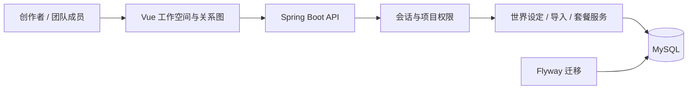

# NovelGraph | 小说世界观与剧情管理平台

**简体中文** | [English](README.en.md)

**把分散的人物、事件和关系设定，整理成可以编辑、关联和追溯的创作工作空间。**

NovelGraph 是一个 Java + Vue 全栈作品，展示从业务建模、接口开发、权限控制到可视化交互的实现能力。项目定位为个人作品展示；不代表付费客户案例，也不声称已有商业规模运营。

[项目案例与演示脚本](docs/CASE_STUDY.md) · [运行与验证](docs/SETUP.md)

## 解决什么问题

小说创作涉及人物、事件、地点、势力和秘密，普通文档很难直观看到关联，也容易在多人编辑时覆盖彼此的修改。NovelGraph 将这些设定组织为结构化数据和关系图，并提供团队权限、快照恢复和不同阅读视角的导出。

## 功能与开发能力

| 产品功能 | 展示的开发能力 |
| --- | --- |
| 人物、事件、地点、势力与关系图 | 业务建模、关联数据管理、Vue Flow 交互 |
| 账号、空间、团队成员及项目权限 | 会话认证、多租户隔离、角色授权 |
| 自动保存、版本检查、快照恢复 | 并发修改校验、数据版本管理 |
| 小说文本提取提示词与 JSON 导入 | 协议校验、预览、事务回滚、引用映射与防重复提交 |
| 套餐额度、订单与运营后台 | 配额控制、订单幂等与人工开通流程 |
| 作者与读者视角导出 | 按章节揭示信息、结构化内容输出 |

## 技术实现

- 后端：Java 8、Spring Boot 2.7.18、MyBatis-Plus、MySQL、Flyway。
- 前端：Vue 3、TypeScript、Vite、Vue Flow、Pinia。
- 认证：Cookie 会话、PBKDF2 密码散列、写操作 CSRF 校验与来源检查。
- 验证：JUnit / Spring 集成测试、H2 测试数据库、Node 前端测试与 TypeScript 检查。

## 代码导航

- `backend/src/main/java/com/aiwriter/saas/security`：会话、密码与请求校验。
- `backend/src/main/java/com/aiwriter/saas/service/impl`：主要业务实现。
- `backend/src/main/resources/db/migration`：数据库演进。
- `backend/src/test`：权限隔离、版本冲突、导入回滚及订单等测试。
- `frontend/src/saas`：编辑器、团队、账户及运营页面。

## 展示状态与边界

本仓库提供源码与运行文档，在线演示地址、实际页面截图和演示视频尚未补齐。AI 提取采用用户复制提示词、粘贴或上传 AI 回答后确认导入的方式；没有集成模型直连服务。套餐订单由管理员人工开通，没有接入在线支付。

当前源码使用 Java 8 / Spring Boot 2.7；承接新项目时应结合部署环境另行评估技术版本。此处展示实现，不提供生产安全审计或性能规模承诺。

## 可以迁移到哪些业务

项目中的账号权限、团队协作、结构化数据管理、批量导入、套餐和运营后台等能力，可用于内容管理平台、内部业务系统及会员服务网站。具体交付范围以客户需求为准。
